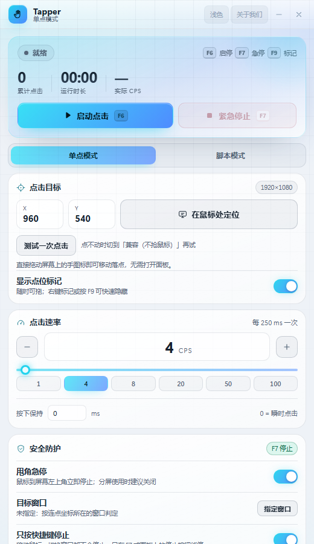
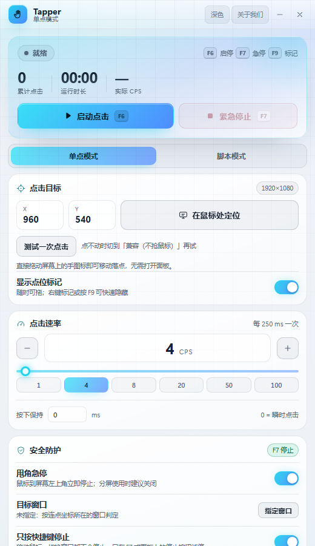

# Tapper · 鼠标连点器

Windows 桌面连点器。把悬浮层上的标记拖到目标位置，设好速率，按 `F6` 开始、`F7` 随时停止。支持单点连点与多段脚本回放两种模式。

<p>
  
  
</p>

## 功能

### 单点模式
- 点「在鼠标处定位」或直接把标记拖到目标，准星即落点（物理像素，多显示器可用）
- CPS 1–50，滑块 + 预设档位 + 按下保持时长；「测试一次点击」可在不启动引擎时校验落点
- 全局热键：`F6` 启停、`F7` 紧急停止、`F8` 录制、`F9` 显隐标记

### 脚本模式
- 录制真实点击序列（坐标 + 间隔），可保存多份脚本、重命名、回放
- 回放按录制节奏执行，同样受 `F7` 急停与失焦保护约束

### 安全防护
- **甩角急停**：鼠标甩到屏幕左上角立即停止，只识别真实用户输入；分屏场景可关闭
- **目标窗口保护**：未指定窗口时按落点所在窗口判定，目标失焦自动停止
- **只按快捷键停止**：可锁定为仅热键能停，避免误触面板
- 启动倒计时，留出切回游戏的时间

### 其他
- 托盘常驻、单实例、配置持久化；关闭面板不停止任务
- 浅色 / 深色 / 跟随系统主题
- 便携版 exe 与 NSIS 安装包两种分发形式

## 架构

| 层 | 位置 | 职责 |
| --- | --- | --- |
| 前端 | `src/` | React + TypeScript 面板与悬浮层 UI，浏览器下走 `src/lib/mock.ts` 预览 |
| 后端 | `src-tauri/src/` | 点击引擎、全局热键、悬浮层窗口、配置持久化 |

两个窗口：主面板（常规窗口）与悬浮层（铺满屏幕的透明窗口）。

**悬浮层的鼠标交互全部在 Rust 侧完成**（`src-tauri/src/overlay_input.rs`）。悬浮层是覆盖全屏的 WebView2 窗口，如果把命中测试交给网页，透明区域会吞掉游戏点击。所以窗口始终保持 click-through，交互改在全局鼠标钩子里做矩形命中测试：命中悬浮层元素时吞掉该次点击，其余一律放行给游戏。

点击通过 `SendInput` 注入，按物理像素坐标换算到对应显示器。配置写入 Tauri 应用数据目录。

## 开发

```bash
npm install
npm run dev            # 浏览器预览（内置 mock 数据，支持 ?theme=light）
npm run tauri dev      # 真实桌面窗口
npm run typecheck && npm test
cargo test --manifest-path src-tauri/Cargo.toml
npm run tauri build    # 产出便携版 exe + NSIS 安装包
node scripts/verify-bundle.mjs
```

打包产物在 `src-tauri/target/release/`，归档版本与发布说明在 `release/`。

## 已知限制

见 [`release/NOTES.md`](release/NOTES.md)。
